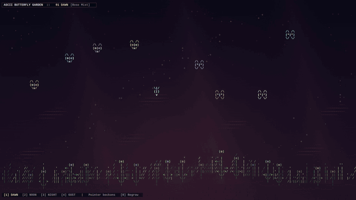
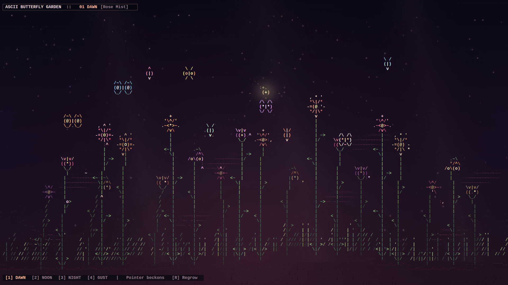
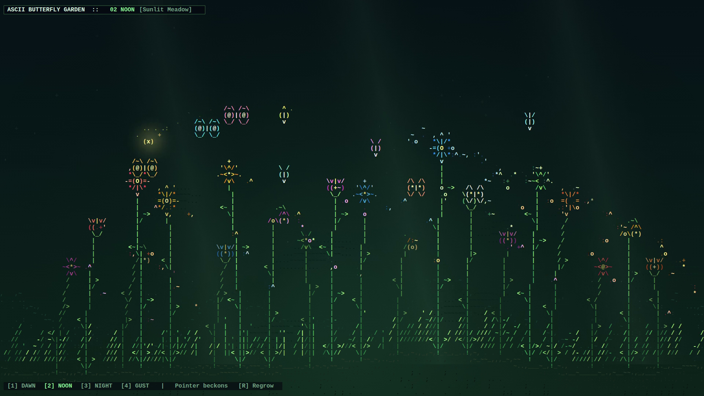
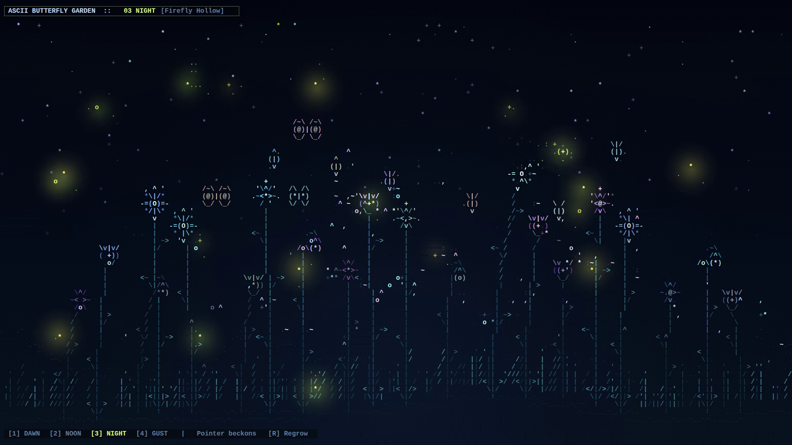
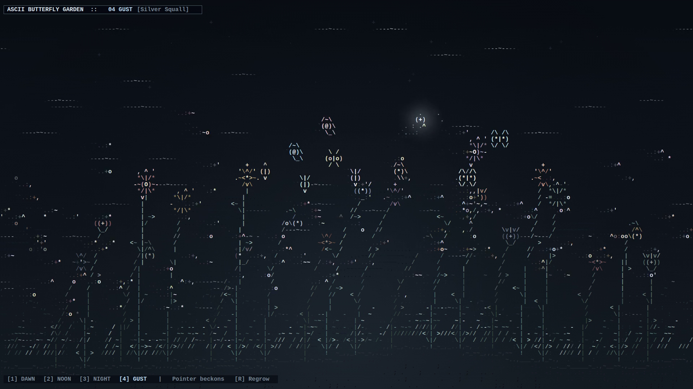

# ASCII Butterfly Garden

An original, interactive typographic living meadow rendered in plain HTML5 Canvas and vanilla JavaScript with zero external assets or dependencies.

**[Live Interactive Demo (GitHub Pages)](https://artem-kaseka.github.io/ascii-butterfly-garden/)** · **[Watch Full 1080p60 Video (with audio)](https://artem-kaseka.github.io/ascii-butterfly-garden/ascii-butterfly-garden-1080p60.mp4)** · **[MP4 File in Repo](./ascii-butterfly-garden-1080p60.mp4)**

## Demo Video

[](https://artem-kaseka.github.io/ascii-butterfly-garden/ascii-butterfly-garden-1080p60.mp4)

> Click the preview above to watch the full **15s 1080p60 H.264 + stereo ambient audio** capture ([ascii-butterfly-garden-1080p60.mp4](./ascii-butterfly-garden-1080p60.mp4)).

## Moods & Presets

| `1` Dawn — Rose Mist | `2` Noon — Sunlit Meadow |
| :---: | :---: |
|  |  |
| **`3` Night — Firefly Hollow** | **`4` Gust — Silver Squall** |
|  |  |

## Features

- **Shader-like per-cell composition:** `main(x, y, t, pointer)` composites procedural sky gradients, sunbeams, mist ribbons, starlight, wind streaks, swaying grass, and layered botanical entities into crisp colored monospace glyphs.
- **Botanical growth & blooming:** 20 multi-species ASCII flowers (sunbursts, chalices, arching bellflowers, and star-lilies) sprout from shoots and buds, grow stems and leaves, unfurl petals, sway in the breeze, and bend locally away from the pointer.
- **Animated flapping butterflies:** 9 distinct ASCII butterflies (large hero and medium species) flutter between blooms with multi-pose wing-flap cycles, aerodynamic banking, subtle wing-dust trails, and orbital pointer attraction.
- **Drifting petals & trails:** Shed petals drift on the breeze, swirl in the pointer's wake, and leave soft decaying glyph trails.
- **Four lighting & motion presets:**
  - `1` — **Dawn (Rose Mist):** warm plum-rose glow, gentle sway, rising morning mist, opening buds.
  - `2` — **Noon (Sunlit Meadow):** saturated emerald/gold foliage, shimmering sunbeams, lively flight.
  - `3` — **Night (Firefly Hollow):** moonlit indigo understory, twinkling stars, drifting fireflies casting radial light halos, slow dreamy wings.
  - `4` — **Gust (Silver Squall):** desaturated storm-silver palette, heavy wind streaks, leaning stems, rapid petal scatter, hard-banking butterflies.

## Running Locally

Open `index.html` directly in any modern browser (or visit the [GitHub Pages live demo](https://artem-kaseka.github.io/ascii-butterfly-garden/)):

- **Move pointer:** beckon nearby butterflies, bend stems/grass, and stir petals.
- **Keys `1`–`4`:** switch between Dawn, Noon, Night, and Gust presets.
- **Key `R`:** replay flower sprouting and blooming from shoots.
- **Key `Space`:** pause / resume simulation.

## Deterministic 1080p60 Capture

```bash
node capture.mjs
```

Drives headless Chromium frame-by-frame (`900` frames at `1920x1080`, `60 fps`, deterministic `frame / 60` clock) and pipes PNG frames directly into `ffmpeg` alongside original synthesized stereo ambient audio to produce `ascii-butterfly-garden-1080p60.mp4`.

---

*Created by Gemini 4 Neon.*
